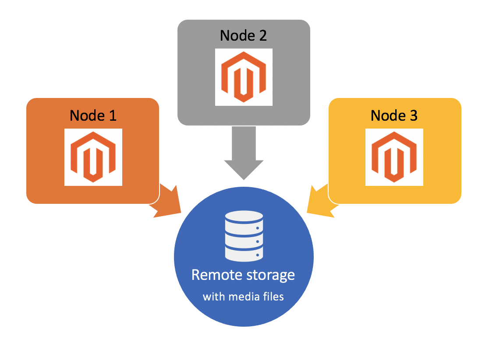

# Configurar o armazenamento remoto

O módulo de Armazenamento remoto oferece a opção de armazenar arquivos de mídia e agendar importações e exportações em um contêiner de armazenamento remoto persistente usando um serviço de armazenamento, como o AWS S3.

Por padrão, o aplicativo do Adobe Commerce armazena arquivos de mídia no mesmo sistema de arquivos que contém o aplicativo. Isso é ineficiente para configurações complexas de vários servidores e pode resultar em redução do desempenho ao compartilhar recursos. Com o módulo de Armazenamento Remoto, você pode armazenar arquivos de mídia no diretório `pub/media` e importar/exportar arquivos no diretório `var` do armazenamento de objetos remoto para aproveitar o redimensionamento de imagens do lado do servidor.

>[!BEGINSHADEBOX]

Você não pode ter armazenamento remoto _e armazenamento de banco de dados_ habilitados ao mesmo tempo. Você deve desabilitar o armazenamento do banco de dados antes de habilitar o armazenamento remoto.

```shell
bin/magento config:set system/media_storage_configuration/media_database 0
```

A habilitação do armazenamento remoto pode afetar sua experiência de desenvolvimento estabelecida. Por exemplo, certas funções de arquivo PHP podem não funcionar como esperado. O uso do Commerce Framework para operações de arquivos deve ser empregado. A lista de funções nativas proibidas do PHP está disponível no repositório [magento-coding-standard](https://github.com/magento/magento-coding-standard/blob/develop/Magento2/Sniffs/Functions/DiscouragedFunctionSniff.php).

>[!ENDSHADEBOX]

>[!INFO]
>
>- O armazenamento remoto está disponível somente para o Commerce versão 2.4.2 e posterior. Consulte as [notas de versão do 2.4.2](/help/release/release-notes/open-source/2-4-2.md).
>
>- O módulo de armazenamento remoto tem _suporte limitado_ no Adobe Commerce na infraestrutura em nuvem. A Adobe não pode solucionar totalmente os problemas do serviço de adaptador de armazenamento de terceiros. Consulte [Configurar armazenamento remoto para a infraestrutura do Commerce na nuvem](cloud-support.md) para obter orientação sobre como implementar o armazenamento remoto em projetos na nuvem.



## Opções de armazenamento remoto

Você pode configurar o armazenamento remoto usando a opção `remote-storage` com o comando ](../../installation/tutorials/deployment.md) da CLI [`setup`. A opção `remote-storage` usa a seguinte sintaxe:

```text
--remote-storage-<parameter-name>="<parameter-value>"
```

`parameter-name` refere-se ao nome do parâmetro de armazenamento remoto específico. A tabela a seguir lista os parâmetros disponíveis para configurar o armazenamento remoto:

| Parâmetro de linha de comando | Nome do parâmetro | Descrição | Valor padrão |
|--- |--- |--- |--- |
| `remote-storage-driver` | driver | Nome do adaptador<br>Valores possíveis:<br>**arquivo**: desabilita o armazenamento remoto e usa o sistema de arquivos local <br>**aws-s3**: Use o [Serviço de Armazenamento Simples da Amazon (Amazon S3)](remote-storage-aws-s3.md) | nenhum |
| `remote-storage-bucket` | balde | Armazenamento de objetos ou nome do container | nenhum |
| `remote-storage-prefix` | prefixo | Prefixo opcional (local dentro do armazenamento de objetos) | vazio |
| `remote-storage-region` | região | Nome da região | nenhum |
| `remote-storage-key` | chave de acesso | Chave de acesso opcional | vazio |
| `remote-storage-secret` | chave secreta | Chave secreta opcional | vazio |

### Adaptadores de armazenamento

O local de armazenamento padrão está no sistema de arquivos local. Um _adaptador de armazenamento_ permite que você se conecte a um serviço de armazenamento e armazene seus arquivos em qualquer lugar. [!DNL Commerce] dá suporte à configuração dos seguintes serviços de armazenamento:

- [Serviço de armazenamento simples da Amazon (Amazon S3)](remote-storage-aws-s3.md)

## Habilitar armazenamento remoto

Você pode instalar o armazenamento remoto durante uma instalação do Adobe Commerce ou adicionar armazenamento remoto a uma instância existente do Commerce. Os exemplos a seguir demonstram cada método usando um conjunto de parâmetros `remote-storage` com comandos CLI do Commerce `setup`. No mínimo, você deve fornecer o armazenamento `driver`, `bucket` e `region`.

- Exemplo: instalar o Commerce com armazenamento remoto

  ```shell
  bin/magento setup:install --remote-storage-driver="aws-s3" --remote-storage-bucket="myBucket" --remote-storage-region="us-east-1"
  ```

- Exemplo: habilitar o armazenamento remoto no Commerce existente

  ```shell
  bin/magento setup:config:set --remote-storage-driver="aws-s3" --remote-storage-bucket="myBucket" --remote-storage-region="us-east-1"
  ```

>[!TIP]
>
>Para o Adobe Commerce na infraestrutura em nuvem, consulte [Configurar armazenamento remoto para a infraestrutura do Commerce na nuvem](cloud-support.md).

## Migrar conteúdo

Depois de habilitar o armazenamento remoto para um adaptador específico, você pode usar a CLI para migrar arquivos de _mídia_ existentes para o armazenamento remoto.

```shell
./magento2ce/bin/magento remote-storage:sync
```

>[!INFO]
>
>O comando sync migra somente arquivos no diretório `pub/media`, _não_ os arquivos de importação/exportação no diretório `var`. Consulte [Importação/Exportação agendada](https://experienceleague.adobe.com/docs/commerce-admin/systems/data-transfer/data-scheduled-import-export.html) no _Guia do Usuário do Commerce 2.4_.

