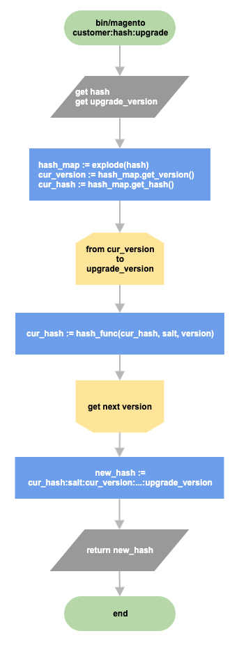
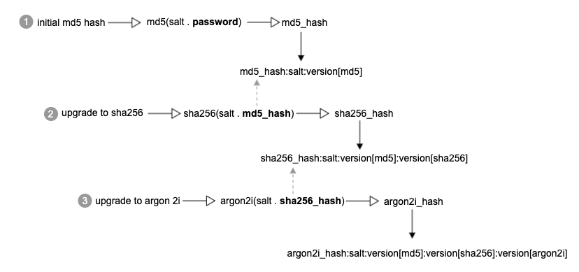

# Hash de senha

Atualmente, o Commerce usa sua própria estratégia para hash de senha, com base em diferentes algoritmos nativos de hash do PHP. O Commerce oferece suporte a vários algoritmos, como `MD5`, `SHA256` ou `Argon 2ID13`. Se a extensão Sodium estiver instalada (instalada por padrão no PHP 7.3), então `Argon 2ID13` é escolhido como o algoritmo de hash padrão. Caso contrário, `SHA256` será o padrão. O Commerce pode usar a função nativa `password_hash` do PHP com suporte ao algoritmo Argon 2i.

Para evitar o comprometimento de senhas mais antigas que receberam hash com algoritmos desatualizados, como `MD5`, a implementação atual fornece um método para atualizar o hash sem alterar a senha original. Em geral, o hash da senha tem o seguinte formato:

```text
password_hash:salt:version<n>:version<n>
```

Onde `version<n>`...`version<n>` representa todas as versões de algoritmos de hash usadas na senha. Além disso, o salt é sempre armazenado junto com o hash de senha, para que possamos restaurar toda a cadeia de algoritmos. Um exemplo se parece com:

```text
a853b06f077b686f8a3af80c98acfca763cf10c0e03597c67e756f1c782d1ab0:8qnyO4H1OYIfGCUb:1:2
```

A primeira parte representa o hash da senha. O segundo, `8qnyO4H1OYIfGCUb` é o sal. Os dois últimos são algoritmos de hash diferentes: 1 é `SHA256` e 2 é `Argon 2ID13`. Isso significa que a senha do cliente foi originalmente enviada com hash com `SHA256` e, depois disso, o algoritmo foi atualizado com `Argon 2ID13` e o hash foi enviado com o Argon.

## Atualizar estratégia de hash

Considere a aparência do mecanismo de atualização de hash. Suponha que, originalmente, uma senha tivesse hash com `MD5` e, em seguida, o algoritmo fosse atualizado várias vezes com o Argon 2ID13. O diagrama a seguir mostra o fluxo de atualização de hash.



Cada algoritmo de hash usa o hash da senha anterior para gerar um novo hash. A Commerce não armazena a senha original bruta.



Como discutido acima, o hash de senha pode ter várias versões de hash aplicadas à senha original.
Veja como o mecanismo de verificação de senha funciona durante uma autenticação do cliente.

```php
def verify(password, hash):
    restored = password

    hash_map = extract(hash)
    # iterate through all versions specified in the received hash [md5, sha256, argon2id13]
    for version in hash_map.get_versions():
        # generate new hash based on password/previous hash, salt and version
        restored = hash_func(salt . restored, version)

    # extract only password hash from the hash:salt:version chain
    hash = hash_map.get_hash()

    return compare(restored, hash)
```

Como o Commerce armazena todas as versões de hash de senha usadas junto com o hash de senha, podemos restaurar toda a cadeia de hash durante a verificação de senha. O mecanismo de verificação de hash é semelhante à estratégia de atualização de hash: com base nas versões armazenadas junto com o hash de senha, o algoritmo gera hashes da senha fornecida e retorna o resultado da comparação entre a senha com hash e o hash armazenado no banco de dados.

## Implementação

A classe `\Magento\Framework\Encryption\Encryptor` é responsável pela geração e verificação do hash de senha. O comando [`bin/magento customer:hash:upgrade`](/help/tools/reference/commerce-on-premises.md#customerhashupgrade) atualiza um hash de senha do cliente para o algoritmo de hash mais recente.
