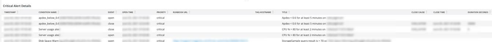

# A guia [!UICONTROL Alerts]

A guia [!UICONTROL Alerts] fornece vários alertas, incluindo alertas críticos para abrir e fechar.

## [!UICONTROL Open Alert Details]

O quadro **[!UICONTROL Open Alert Details]** mostra uma contagem dos alertas críticos abertos no período selecionado. Os alertas incluirão alertas criados pela Adobe e qualquer um criado pelo parceiro ou comerciante.

## [!UICONTROL Closed Critical Alerts]

O quadro **[!UICONTROL Closed Critical Alerts]** mostra uma contagem dos alertas críticos fechados durante o período selecionado. Os alertas incluirão alertas criados pela Adobe e qualquer um criado pelo parceiro ou comerciante.

## [!UICONTROL Critical Alert Details]

O quadro **[!UICONTROL Critical Alert Details]** mostra uma contagem dos detalhes críticos do alerta no período selecionado, incluindo carimbo de data e hora, nome da condição e se o evento de alerta está aberto ou fechado.

## [!UICONTROL Infrastructure Alert Details]

O quadro **[!UICONTROL Infrastructure Alert Details]** mostra aplicativos, hosts e outros eventos de infraestrutura no período selecionado.
