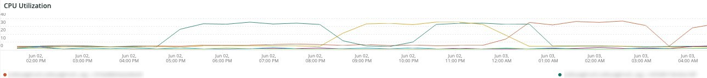

# A guia [!DNL QuickView]

A guia **[!UICONTROL QuickView]** explica os diferentes tipos de alertas exibidos, incluindo aqueles com pouco espaço em disco e uso do servidor. Além disso, os quadros da guia são descritos.

## [!UICONTROL Alerts]

O quadro **[!UICONTROL Alerts]** mostra alertas diferentes, incluindo avisos de espaço em disco e alertas de uso do servidor em um período selecionado. Este quadro analisa as operações de tabela de banco de dados incluindo `SELECT`, `DELETE` e `UPDATE` em um período selecionado.

## [!UICONTROL Upsize / Downsize by node]

O quadro **[!UICONTROL Upsize / Downsize by node]** mostra upsize e downsize por nó em um período selecionado. Isso é usado para avaliar se houve uma alteração no tamanho do cluster durante o período selecionado.

## [!UICONTROL CPU Utilization]

O quadro **[!UICONTROL CPU Utilization]** mostra a utilização do CPU por nós no período selecionado.
