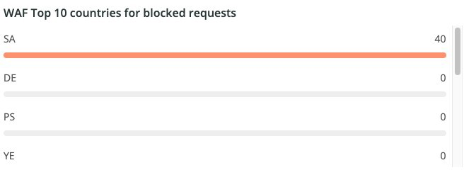
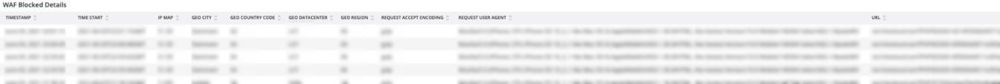

# A guia [!DNL WAF]

A guia **[!DNL WAF]** mostra o tráfego passado e bloqueado pelo [!DNL firewall].

## [!DNL WAF traffic summary]

O quadro **[!DNL WAF traffic summary]** mostra uma contagem de tráfego aprovado, registrado, bloqueado e com falha pelo [!DNL firewall].

## [!DNL WAF Top 10 blocked IP Addresses]

O quadro **[!DNL WAF Top 10 blocked IP Addresses]** mostra os 10 principais endereços IP mais bloqueados pelo [!DNL firewall].

## [!DNL WAF Top 10 countries for blocked requests]

O quadro **[!DNL WAF Top 10 countries for blocked requests]** mostra uma contagem de solicitações bloqueadas para países entre os 10 primeiros para solicitações bloqueadas pelo [!DNL firewall].

## [!DNL WAF Top 10 logged IP Addresses]

O quadro **[!DNL WAF Top 10 logged IP Addresses]** mostra endereços IP nos 10 principais endereços IP registrados pelo [!DNL firewall].

## [!DNL Top 10 WAF Rules Executed and Logged by IP address]

O quadro **[!DNL Top 10 WAF Rules Executed and Logged by IP address]** mostra endereços IP que estão entre as 10 regras de [!DNL firewall] que mais correspondem.

## [!DNL WAF Logged Details]

O quadro **[!DNL WAF Logged Details]** mostra solicitações registradas pelo [!DNL firewall], incluindo detalhes como carimbo de data/hora, cidade, região e data center.

## [!DNL WAF Blocked Details]

O quadro **[!DNL WAF Blocked Details]** mostra solicitações bloqueadas pelo [!DNL firewall], incluindo detalhes como carimbo de data/hora, cidade, região e data center.
