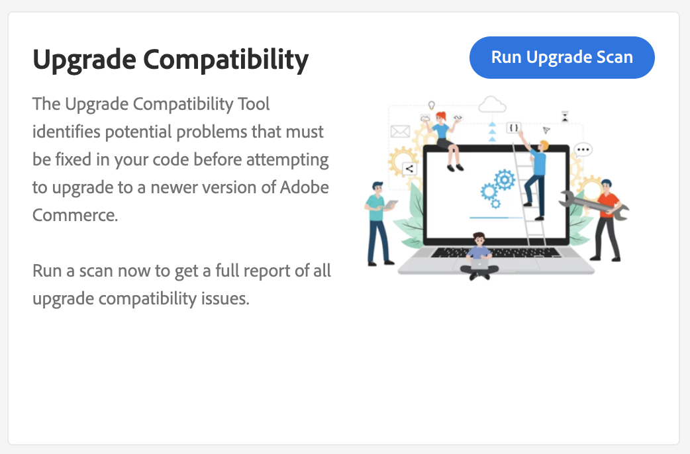
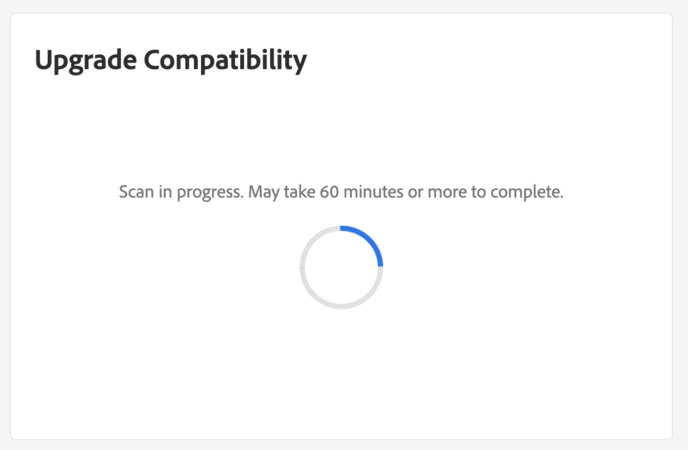

# Integrar o [!DNL Site-Wide Analysis Tool]

O [!DNL Site-Wide Analysis Tool] fornece monitoramento, relatórios e recomendações de desempenho em tempo real 24 horas por dia, 7 dias por semana, para garantir a segurança e a operabilidade das instâncias do Adobe Commerce.

O [!DNL Upgrade Compatibility Tool] agora está integrado ao [!DNL Site-Wide Analysis Tool] para fornecer a capacidade para que pessoas não técnicas executem o [!DNL Upgrade Compatibility Tool] e obtenham um [relatório](../upgrade-compatibility-tool/reports.md) contendo uma lista de problemas para cada arquivo.

Consulte o [[!DNL Site-Wide Analysis Tool] guia do usuário](/help/tools/site-wide-analysis-tool/access.md) para obter mais informações.

## Executar o [!DNL Upgrade Compatibility Tool] a partir do [!DNL Site-Wide Analysis Tool]

Navegue até o painel [!DNL Site-Wide Analysis Tool] do seu projeto e localize o widget [!DNL Upgrade Compatibility Tool].

Clique em **[!UICONTROL Run Upgrade Scan]**. A verificação pode levar algum tempo, dependendo do tamanho do projeto. Um ponteiro indica que a verificação está em andamento.

Após a conclusão da verificação, os resultados de alto nível são exibidos no widget.

Clique em **[!UICONTROL Download Report]** para recuperar o [!DNL Upgrade Compatibility Tool] [relatório do HTML](../upgrade-compatibility-tool/reports.md#html-report) e examinar os detalhes.

>[!NOTE]
>
> Executar o [!DNL Upgrade Compatibility Tool] por meio do [!DNL Site-Wide Analysis Tool] otimiza os resultados e ajuda você a se concentrar em problemas novos e críticos para a atualização de destino. Ela usa a opção [`--ignore-current-version-compatibility-errors`](run.md#optimize-your-results) e sempre mostra resultados comparando a versão do seu projeto com a versão mais recente lançada.
